# Christchurch Supermarket Price Tracker

[](https://github.com/ANamTHONY/CHCH-supermarket-price-tracker/actions/workflows/tests.yml)

An end-to-end data engineering project that collects supermarket prices in
Christchurch, New Zealand, and turns daily observations into auditable Delta
tables for analysis in Databricks and Power BI.

**28 stores · 3 supermarket chains · eggs, milk and meat · Python + Spark SQL + Delta Lake**

The latest Power BI report adds store comparisons, member-inclusive prices,
seven-day product histories and an exploratory weekday view for 15 selected
products. Collection starts on **27 October 2026**. This is an engineering
portfolio and an early observational study, not a validated shopping forecast.

See [Power BI report and methodology](docs/POWER_BI_REPORT.md) for the current
pages, metric definitions and limits. This repository documents the report
without publishing the PBIX, report screenshots or the underlying price history.

The project addresses a practical comparison problem: prices depend on the
selected store, product sizes differ, and a successful browser session does not
necessarily mean that every product or price has loaded.

## Architecture

```mermaid
flowchart LR
    A[Windows Task Scheduler] --> B[Python / Selenium collectors]
    B --> C[Store verification and pagination checks]
    C --> D[Local CSV, details and run manifest]
    D --> E[Unity Catalog Volume]
    E --> F[Immutable ready-batch marker]
    F --> G[Databricks single-writer Job]
    G --> H[Bronze: raw observations and ingestion ledger]
    H --> I[Silver: prices and dimensions]
    I --> J[Gold: comparison and quality views]
    J --> K[Power BI / SQL analysis]
```



The working deployment collects on a local Windows machine and processes data
in Databricks. GitHub Actions runs automated tests. Cloud-hosted browser
collection is an experiment: supermarket access challenges prevented the cloud
probe from succeeding, so its daily collection workflow remains gated.

## What makes the pipeline reliable

- **Correct store identity:** verify the selected store before publishing its data.
- **Dynamic listings:** follow actual pagination and deduplicate source SKUs.
  Product counts may change every day; yesterday's count is not a fixed pass criterion.
- **Price readiness:** wait for the public price widget. Member prices and savings
  labels cannot substitute for a missing public selling price.
- **Explicit completion:** retain incomplete store output locally; publish only
  completed store files and then a ready-batch marker.
- **Recoverable ingestion:** a single-writer Databricks Job processes pending
  batches, records their state, and replaces the selected store/day in Bronze.
  Reprocessing does not append duplicate observations for that store/day.
- **Confirmed outcomes:** an accepted job submission is not considered a successful
  ingestion until the exact batch's ledger state is checked. Temporary submission
  restrictions get bounded retries; permission failures remain visible.
- **Quality evidence:** reconcile run manifests with Bronze/Silver and check
  duplicate observation IDs, missing identifiers, store verification and dimension joins.

## A real daily result

The saved audit for **18 November 2026, Pacific/Auckland** recorded:

| Chain | Stores | Price observations |
| --- | ---: | ---: |
| New World | 11 | 5,833 |
| PAK'nSAVE | 5 | 2,623 |
| Woolworths | 12 | 5,596 |
| **Total** | **28** | **14,052** |

That day's Silver audit found no missing public prices, zero prices, duplicate
observation IDs, missing source SKUs, missing product URLs or orphan dimension
keys. These are results for this date, not guarantees for future runs.
See the [sanitized audit summary](docs/sample-run-summary.json).

**Collection coverage is broader than comparison coverage.** On this date, 597
observations mapped to the curated product catalogue. The analysis set selects
15 products; other observations remain available as source products. Meat
comparisons are deliberately marked not ready where equivalence is unverified.
Unit normalization and product mapping remain ongoing work.

## Try the project

Python **3.14** is the tested runtime. Chrome is required for live collection.
The regression tests use mocks and temporary files; they need neither a browser
session nor Databricks credentials.

```powershell
git clone https://github.com/ANamTHONY/CHCH-supermarket-price-tracker.git
cd CHCH-supermarket-price-tracker
py -3.14 -m venv .venv
.\.venv\Scripts\python.exe -m pip install -r requirements.txt
.\.venv\Scripts\python.exe -m unittest discover -s tests
```

On Linux, create the environment with `python3.14 -m venv .venv` and use
`.venv/bin/python` for the same commands.

Only run live collection where you have permission and have checked the site's
current terms. Public visibility of prices is not permission to automate access
or redistribute data. The offline tests above are the default way to explore
the project. For an authorized small live collection without production uploads:

```powershell
.\.venv\Scripts\python.exe run_pipelines.py --source woolworths --stores 001 --test --limit 5 --workers 1 --retries 0
```

This performs a real website request and may fail if the website blocks the
environment or changes its interface. It is separate from the offline tests.

For a production deployment, configure Databricks authentication and an existing
Volume, deploy the ingestion notebook/Job, and set `DATABRICKS_INGESTION_JOB_ID`.
See [production setup](docs/SETUP.md). Credentials and raw run data are excluded
from this repository.

## Explore the code

| Area | Entry points |
| --- | --- |
| Orchestration and run manifests | [run_pipelines.py](run_pipelines.py), [production_runner.py](production_runner.py) |
| Brand collectors | [foodstuffs_scraper.py](foodstuffs_scraper.py), [woolworths_scraper.py](woolworths_scraper.py) |
| Local storage and batch publication | [price_storage.py](price_storage.py), [publish_batch.py](publish_batch.py), [batch_protocol.py](batch_protocol.py) |
| Cloud submission and recovery | [trigger_cloud_job.py](trigger_cloud_job.py), [recover_run.py](recover_run.py) |
| Databricks processing | [cloud_batch_ingest.py](cloud_batch_ingest.py), [notebooks/](notebooks/) |
| Data model and curated mappings | [product_model.py](product_model.py), [silver_rules.py](silver_rules.py), [reference/](reference/) |
| Validation | [daily_checks.py](daily_checks.py), [tests/](tests/), [tools/audit_daily_prices.py](tools/audit_daily_prices.py) |
| Current BI report and methodology | [docs/POWER_BI_REPORT.md](docs/POWER_BI_REPORT.md), [powerbi_product_value_daily.dax](powerbi_product_value_daily.dax), [powerbi_store_value_map.sql](powerbi_store_value_map.sql) |
| Product mapping and historical design notes | [PRODUCT_ANALYSIS.md](PRODUCT_ANALYSIS.md), [POWER_BI_PLAN.md](POWER_BI_PLAN.md) |

The existing operational notes include earlier deployment approaches. Start with
this README and [production setup](docs/SETUP.md) for the current architecture.

## Design decisions to discuss

1. **Source identity versus canonical products:** source SKU history stays intact
   while cross-chain matching is a smaller, reviewed mapping layer.
2. **Collection versus ingestion:** durable files and ready markers allow cloud
   ingestion to recover without scraping the same products again.
3. **Completeness versus changing stock:** check traversal and page identity;
   treat displayed-count drift as evidence to investigate, not a fixed row target.
4. **Visible failure versus silent substitution:** preserve missing or unavailable
   prices and diagnostics rather than inventing a value from unrelated page text.

## Current limits

Browser selectors depend on retailer interfaces. A daily snapshot is not a
real-time inventory feed. Canonical mapping covers a selected subset. The Power BI
report has been built and published during development; this repository shares
its methodology and selected SQL, M and DAX assets, not a self-contained report
deployment. Public ArcGIS embedding remains unresolved.
The automated tests exercise parsing, state transitions, publication, recovery
and scheduling rules; they do not prove that live retailer pages are reachable.

## Early observations, not shopping advice

As of **19 November 2026**, the reviewed BI sample suggests:

- **Woolworths:** matched products show relatively consistent prices across the
  observed Christchurch stores. This does not establish a chain-wide uniform
  pricing policy, cover every product, or mean prices never change over time.
- **New World and PAK'nSAVE:** observed prices can differ between stores for the
  same matched product and pack size. Store selection can therefore matter.
- **Day of week:** Friday has a lower share of products below their own recent
  baseline than some other weekdays in parts of the current sample. This is an
  exploratory pattern, not evidence that shoppers should generally avoid Friday.

These are descriptive observations from the development report, not independently
reproduced statistical results in this repository. The weekday view has only a
few weeks of collected history and roughly one or two eligible dates per weekday
in the reviewed sample. Fifteen tracked products and repeated observations across
stores do not constitute a representative grocery basket or many independent weeks.
More complete weeks, stable coverage and sensitivity checks are needed before
making a buying-day recommendation.

## Data access and public portfolio scope

This is an independent project with no retailer affiliation or endorsement.
Code availability does not grant permission to collect or reuse retailer data.
Respect site terms and access restrictions; do not bypass access challenges.
In particular, [Woolworths NZ's terms](https://www.woolworths.co.nz/help/terms-conditions/online-shopping-website-app)
restrict scraping and redistribution without prior written consent outside the
stated personal-use allowance. Check the
[New World](https://www.newworld.co.nz/terms-and-conditions) and
[PAK'nSAVE](https://www.paknsave.co.nz/terms-and-conditions) terms as well.
Offline tests and code review do not require retailer access. Raw collection
files, credentials, browser sessions and imported Power BI report files are not
part of the public portfolio.
