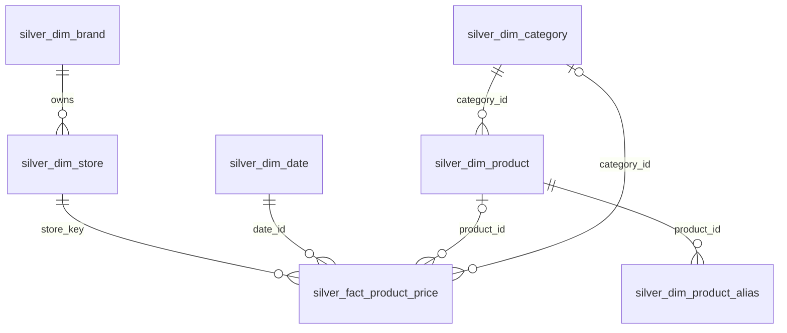

# 价格数据模型

所有表位于 `workspace.default`。原始表从 `prices_bronze` 改名为
`bronze_prices`，保留已有数据。命名规则：层级在前，其次是 dim/fact。

| 表 | 用途与键 |
|---|---|
| bronze_prices | 每日采集原始记录；按 source/store_id/collected_date 替换 |
| silver_dim_brand | 超市品牌；brand_id = woolworths/newworld/paknsave |
| silver_dim_store | 门店名称、品牌、地址、经纬度；store_key = source:store_id |
| silver_dim_category | 1 蛋类、2 奶类、3 肉类 |
| silver_dim_product | 标准品名、分类、规格、数量和单位；沿用 Excel 四位 product_id |
| silver_dim_product_alias | 超市来源、原始品名、原始规格 → 标准 product_id |
| silver_dim_date | 日期及年、季度、月、星期；date_id = yyyyMMdd |
| silver_fact_product_price | 每日/超市/门店/原始品名/规格/原始分类的一条报价 |

`brand` 指超市连锁品牌；商品生产商品牌预留在商品维度的
`product_brand_name`，目前没有可靠来源，留空。store_id 始终为字符串。

门店位置参考保存在 `reference/store_locations.json`，通过
`tools/sync_store_locations.py` 写入同一张 `silver_dim_store`，不建立单独坐标表。
New World 与 PAK'nSAVE 参考官方门店页的 UUID、地址和坐标。
Woolworths 参考 Silver Fern Farms 供应商名录；四家门店另与 OSM 地图核对。
尚未完成地图交叉检查的供应商坐标保留 `location_verified=false`，
`location_status=supplier_directory_pending_map_check`，不要视为测绘级精度。
来源地址、坐标来源、核实日期及市区范围标记均保存在门店表。
Ashburton 保留历史 ID，`is_christchurch_urban=false`。
补充的门店维度记录不会自动改变本地采集脚本的门店列表。

## 运行顺序

1. 首次运行 `setup_price_model`，创建缺失表并添加缺失参考数据。
2. 每天运行 `ingest_daily_prices`，完成 CSV → bronze → 维度补充 → 价格事实表。

初始化引用数据只插入缺失键。更正已有映射或门店资料时直接更新维度表；
重新运行初始化不会覆盖手工修正。

当前数据量小，事实表每天由全部 bronze 数据重建，一次原子覆盖。
不会累加重复记录，原始数据历史仍在 bronze 中。后续规模增长再改为按日增量替换。
单个事实表写入是原子的，整个 Notebook 的多表更新不是一个事务；失败后重跑。

同店同日有多个采集文件时，bronze 使用文件名中采集时间最新的一份。
部分采集文件也可能成为最新批次，运行前检查文件与行数预览。
事实表按业务粒度去重，不能区分“同名、同规格、同分类但网页 SKU 不同”的商品；
以后采集源站商品 ID 时应将其纳入粒度。

## 价格与质量

价格使用 `DECIMAL(12,4)`。无法转换或负数总价在事实表中为空，原文仍保留在 bronze。
`price_quality_status` 标记问题。
`reported_unit_price` 与 `reported_unit` 是采集脚本报告的值，尚未跨超市标准化。
不要据此直接比较每 kg、L 或个的成本。

有合法的旧 product_id 时优先沿用；否则按原始名称和规格精确匹配商品别名。
未映射商品不会丢弃，product_id 为 NULL，product_mapping_status 为 unmapped。
肉类的通用描述不一定是完全可比的同款商品，需要后续细化。

声明的主键/外键用于表达模型关系；Databricks 不自动执行唯一性和引用完整性检查。
部署脚本会检查事实 ID 唯一性及门店引用。
